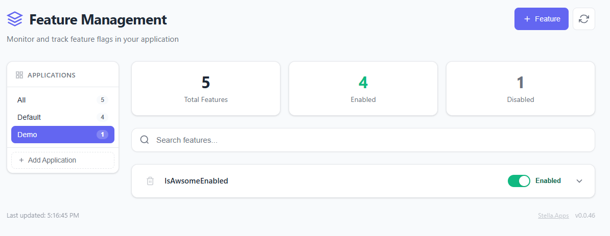

# Stella.FeatureManagement.Dashboard
[](https://github.com/rochar/Stella.FeatureManagement.Dashboard/actions/workflows/ci.yml)
[](https://www.nuget.org/packages/Stella.FeatureManagement.Dashboard)
[](https://www.nuget.org/packages/Stella.FeatureManagement.Dashboard)


A ready-to-use web dashboard for managing feature flags in ASP.NET Core applications. Built on top of Microsoft.FeatureManagement with PostgreSQL persistence, it provides a web UI and REST APIs to view, enable, disable, and configure feature flags at runtime.



## Installation

Install via NuGet Package Manager:

```bash
dotnet add package Stella.FeatureManagement.Dashboard
```

Or via Package Manager Console:

```powershell
Install-Package Stella.FeatureManagement.Dashboard
```

## Quick Start

> **Note:** This library currently uses PostgreSQL as the database provider for storing feature flags.

### 1. Register Services

In your `Program.cs`, add the Feature Management services with the dashboard:

```csharp
...
using Stella.FeatureManagement.Dashboard;
...
// Add Feature Management with Dashboard
builder.Services.AddFeatureManagement()
    .AddFeaturesDashboard(options => options.UseNpgsql(builder.Configuration.GetConnectionString("exampledb")));

var app = builder.Build();

// Map the dashboard endpoints
var featureDashboard = app.UseFeaturesDashboard();
// Update features database model
await featureDashboard.MigrateFeaturesDatabaseAsync();

// Ensure default features are initialized
await featureDashboard.RegisterManagedFeaturesAsync([
    new ManagedFeature("MyFlag", "My feature flag description", true),
    new ManagedFeature("AnotherFlag", string.Empty, false)
]);
    
app.Run();
```

### 2. Access the Dashboard

Once your application is running, access the web dashboard at:

```text
/features/dashboard/
```

### 3. Rate Limiting

You can protect the `/features/{featureName}` endpoint with rate limiting by registering a policy and passing its name:

```csharp
using System.Threading.RateLimiting;
using Stella.FeatureManagement.Dashboard;

// Register a rate limiting policy
builder.Services.AddRateLimiter(options =>
{
    options.AddFixedWindowLimiter("featuresPolicy", opt =>
    {
        opt.Window = TimeSpan.FromSeconds(10);
        opt.PermitLimit = 100;
        opt.QueueLimit = 0;
    });
});

var app = builder.Build();

// Enable the rate limiter middleware
app.UseRateLimiter();

// Pass the policy name to UseFeaturesDashboard
var featureDashboard = app.UseFeaturesDashboard(rateLimitingPolicy: "featuresPolicy");
```

### 4. REST API

You can query feature state through the public endpoint and manage dashboard data through the dashboard API:

```text
GET /features/{featureName}
GET /features/dashboardapi/features
GET /features/dashboardapi/filters
GET /features/dashboardapi/applications
GET /features/dashboardapi/usage?days=7
GET /features/dashboardapi/usage/{featureName}?days=30
```

The `/features/{featureName}` endpoint returns a boolean feature state. The `/features/dashboardapi/*` endpoints are used by the dashboard UI for feature management.

`GET /features/dashboardapi/filters` lists the filters the dashboard offers as `[{ "name": "...", "defaultSettings": "..." }]`.
`defaultSettings` is the registered default as a JSON string, or `null` for a filter registered without
defaults (see [Custom filters](#7-custom-filters)).

#### Updating a feature: `PUT /features/dashboardapi/features/{featureName}`

The body replaces `isEnabled`, `description`, `filters` and (when sent) `application`. A body that omits
`filters` (or sends `null`) clears every filter of the feature, so always send the full list you want to keep.
This is unchanged behaviour; `IFeatureFlagStore` refuses null `Filters` instead. Add the optional
`expectedUpdatedAt` to make the write a compare-and-set: send the `updatedAt` you read when the edit began,
exactly as the API returned it (UTC, ending in `Z`).

- **Current token** → `200` with the updated feature; its `updatedAt` always moves strictly forward.
- **Stale token** → `409` with `{ "message": "...", "feature": { ...current state... } }`; nothing is written.
- **Stale token, but the body equals the stored state** → `200` with the current feature, not `409`: the
  state you asked for is already stored, so nothing is lost. Nothing is written and `updatedAt` does not move.
- **Token without `Z`, or with an offset** → `400` with `{ "message": "..." }`; nothing is written.
- **Validation refused** (filter parameters that do not match the filter's settings type, over 4000
  characters, or a custom `OnFeatureChanging` rule) → `400` whose body is a bare JSON string holding the
  message, not an object; nothing is written.
- **No token** → last write wins, as before. A body that equals the stored state no longer advances
  `updatedAt` (nothing is written).

`DELETE` returns `409` instead of a server error when the feature changes while the delete is in progress.

### 5. Filters combine with OR

An enabled feature with several filters is on when **any** filter passes (`RequirementType.Any`); a disabled
feature is off whatever its filters say, and an enabled feature without filters is always on. So, on a
feature that already has filters, adding another can only widen who gets it.

Filter parameters are validated against the registered filter's settings type on every create and update
(unknown properties, including wrong casing, are refused). For a registered filter type, `parameters`
longer than 4000 characters (the column size) are refused with `400`. Null parameters are accepted and
validated as `{}`; an empty or whitespace-only string is not valid JSON and is refused with `400`.

### 6. Reading and writing features from code: `IFeatureFlagStore`

`AddFeaturesDashboard(...)` registers `IFeatureFlagStore`, the supported way for application code to change
stored features. It goes through the same write path, validation and concurrency check as the dashboard.

```csharp
public sealed class EnableForUser(IFeatureFlagStore store)
{
    public async Task<bool> TryAsync(string featureName, FeatureFilterDto filter, CancellationToken ct)
    {
        var feature = await store.FindFeatureAsync(featureName, ct);
        if (feature is null) return false;

        var requested = feature with { Filters = [.. feature.Filters!, filter] };
        if (store.ValidateFeature(requested).Cancel) return false;      // preview, writes nothing

        var result = await store.UpdateFeatureAsync(requested, ct);    // compare-and-set on UpdatedAt
        return result.Status is FeatureFlagUpdateStatus.Updated or FeatureFlagUpdateStatus.Unchanged;
        // On Conflict, result.Feature is the current state: re-plan from it and try again.
    }
}
```

- `FindFeatureAsync` / `ListFeaturesAsync` return filters in the order they were written, and UTC timestamps.
- `UpdateFeatureAsync(feature)` replaces `IsEnabled`, `Description`, `Application` and `Filters` only if the
  stored `UpdatedAt` still equals `feature.UpdatedAt`. Its `FeatureFlagUpdateResult.Status` is one of:
  - `Updated` — written; `UpdatedAt` moved strictly forward (even if clocks differ between writers).
  - `Unchanged` — the requested state already equals the stored state (fields and the ordered filter list,
    compared exactly). Nothing is written and `UpdatedAt` does not move. **This is checked before the
    token**, so a stale `UpdatedAt` with an already-stored state returns `Unchanged`, not `Conflict`.
  - `Conflict` — another writer changed the feature first; nothing is written and `Feature` is the current state.
  - `Rejected` — validation refused it (including your `OnFeatureChanging` validator); `Message` says why.
  - `NotFound` — no feature with that name.
- **Arguments:** `UpdatedAt` must be the UTC value you read (null or non-UTC throws `ArgumentException`), and
  `Filters` must not be null (it throws; pass an empty list to remove every filter on purpose).
- `ValidateFeature(feature)` runs exactly the validation `UpdateFeatureAsync` runs, as an update, and writes
  nothing.

### 7. Custom filters

Register your own `Microsoft.FeatureManagement` filters on the builder returned by `AddFeaturesDashboard(...)`.
Either overload registers the filter with `Microsoft.FeatureManagement` and lists it in the dashboard under its
`FilterAlias` (else its class name), and both validate saved parameters against the settings type:

```csharp
builder.Services
    .AddFeaturesDashboard(options => options.UseNpgsql(connectionString))
    // With defaults: the dashboard pre-fills the editor with them; the settings type is the instance's type.
    .AddFeatureFilter<TestFilter>(new TestFilterSettings { Ids = [3, 4] })
    // Without defaults: the dashboard opens a blank editor; parameters are validated against the second type.
    .AddFeatureFilter<BlankTestFilter, BlankTestFilterSettings>();
```

- A filter registered without defaults is listed by `GET /features/dashboardapi/filters` with
  `defaultSettings: null`.
- In the dashboard, a parameters editor left blank (or holding only whitespace) saves `parameters: null`,
  for every filter. Null parameters are validated as `{}`, so they pass whenever the settings type has no
  required members, and the filter receives no configuration: write the filter to treat missing settings
  as "match nobody" (or whatever empty means for it).
- The first registration of a filter type wins, whichever overload made it.
- `TSettings` must be a concrete type: an abstract or interface settings type throws `ArgumentException`
  at registration, since parameters could never be deserialized into it.
- `AddFeatureFilter<TFilter, TSettings>()` is a default interface member of `IFeatureManagerDashboardBuilder`
  that throws `NotSupportedException`; the builder `AddFeaturesDashboard(...)` returns implements it. Only
  your own implementation of that interface would need to implement it too.